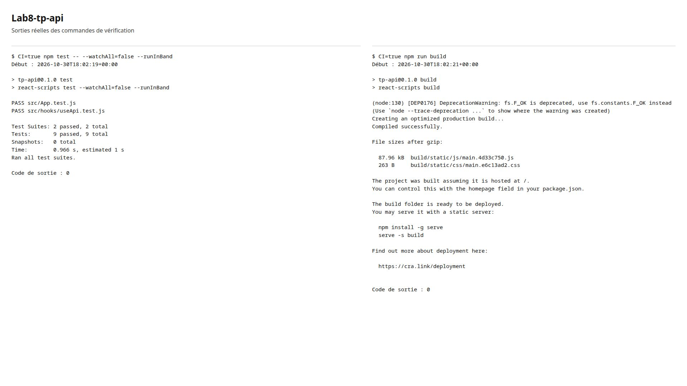
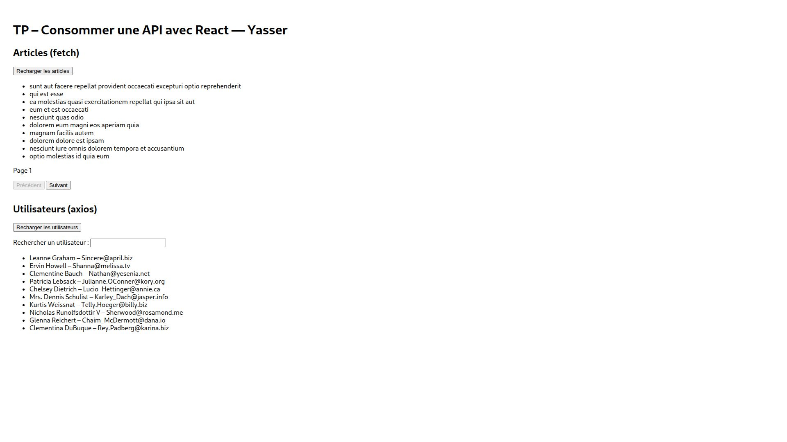
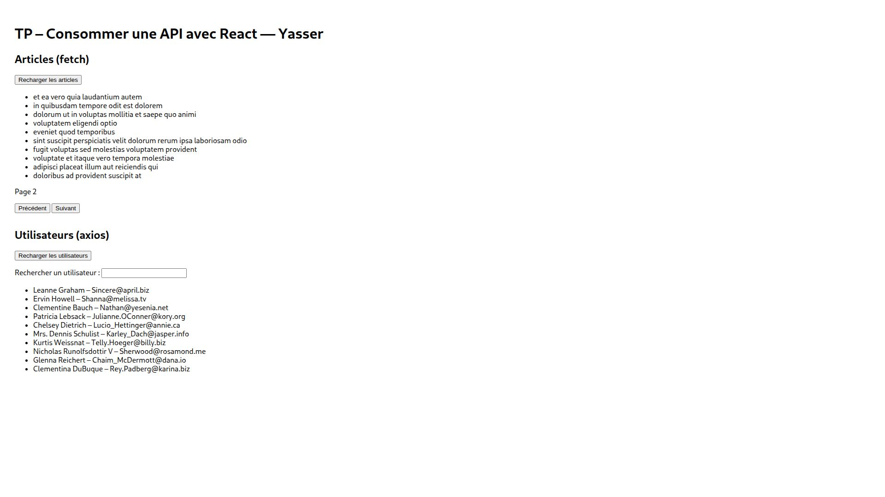
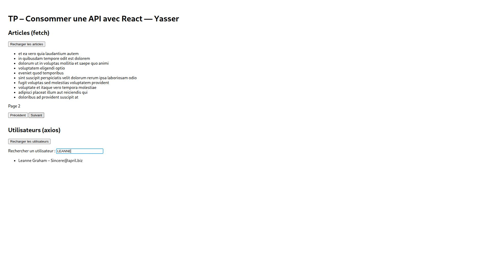

# Lab8-tp-api

Articles chargés avec Fetch et utilisateurs avec leurs emails chargés avec Axios.
Le hook `src/hooks/useApi.js` partage la gestion des données, du chargement, des erreurs et du rechargement.

## Installation et lancement

Dans le dossier du projet :

```bash
npm ci
npm start
```

Ouvrir l’URL indiquée dans le terminal, généralement `http://localhost:3000`.

## Fonctionnalités

- Bouton de rechargement pour chaque liste, désactivé pendant la requête.
- Articles paginés par dix avec `_page` et `_limit=10`, boutons Précédent/Suivant et numéro de page.
- Recherche des utilisateurs par nom, sans distinction entre majuscules et minuscules.
- Messages de chargement et d’erreur pour les deux clients HTTP.

## Tests et build

```bash
CI=true npm test -- --watchAll=false --runInBand
npm run build
```

Résultats : **2 suites et 9 tests réussis**, puis **Compiled successfully** pour le build.
Les tests utilisent des réponses simulées pour vérifier le chargement, les erreurs et le rechargement, la pagination, la recherche, le blocage des requêtes répétées et les réponses arrivant dans le désordre.

Sorties des commandes de tests et de build.



## Affichage

Vérification dans le navigateur après lancement avec `npm start`.
La première page affiche dix articles et les dix utilisateurs de JSONPlaceholder.



Le bouton Suivant affiche la page 2, avec les articles 11 à 20.



La recherche « LEANNE » conserve uniquement Leanne Graham.



Une recherche sans correspondance affiche « Aucun utilisateur trouvé. ».


Effacement de la recherche et rechargement des deux listes vérifiés.
